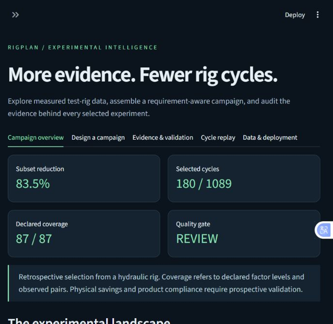
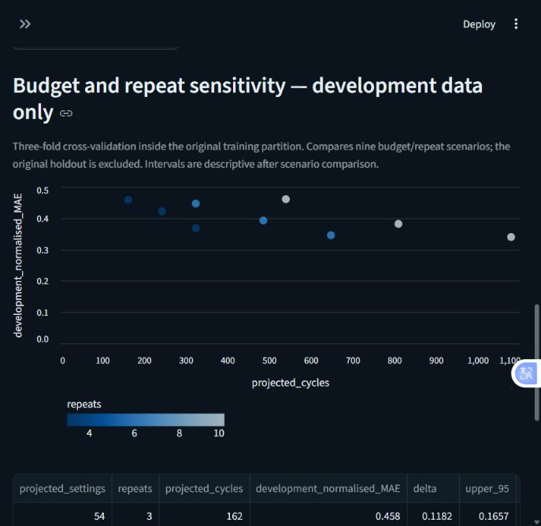
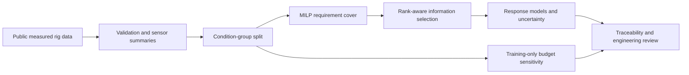

# RigPlan

### Requirement-aware rig test planning with experimental design

[](https://github.com/Pavan-amikula/rigplan/actions/workflows/ci.yml)
[](https://pavan-amikula.github.io/rigplan/)
[](pyproject.toml)
[](LICENSE)
[](#dataset-and-attribution)

**By [Amikula Pavan Kumar Goud](https://github.com/Pavan-amikula)**

RigPlan investigates how historical test-rig data can support smaller experimental campaigns while retaining requirement coverage and useful statistical information. It combines constrained optimisation, experimental design and a separate validation gate in an auditable Python workflow.

**[Explore interactive results →](https://pavan-amikula.github.io/rigplan/)** · [Methods](docs/METHODOLOGY.md) · [Benchmark](reports/BENCHMARK.md) · [Deployment](docs/DEPLOYMENT.md)

| Measured cycles | Declared requirements | Response channels evaluated | Development scenarios |
|:---:|:---:|:---:|:---:|
| **2,205** | **87** | **5** | **9 × 3 CV folds** |

> **Key finding:** covering every declared requirement does not guarantee retained predictive information. The original aggressive reduction fails its held-out gate. A separate development study shortlists a more conservative repeat-reduction scenario for independent validation.

## Interactive experience

- **Browser results explorer:** choose setting budgets and repeat counts, inspect the cost–information tradeoff, and download audit data. Uses precomputed study results; no account or Python installation needed.
- **Full Streamlit workbench:** run locally to optimise a new campaign preview, inspect requirement coverage and model rank, sequence settings, export plans, and replay recorded sensor summaries.

<details>
<summary><strong>See the Streamlit workbench</strong></summary>





</details>

## Architecture



## Quick start

Python 3.11–3.13. From this repository:

```powershell
python -m venv .venv
.venv\Scripts\Activate.ps1
python -m pip install -e ".[dev]"
python -m streamlit run app.py
```

Open http://localhost:8501. The small processed dataset and report artifacts are included, so the dashboard works without downloading the large raw archive. On Windows, `scripts/start.ps1` launches the installed app.

Rebuild from original measurements (downloads a ~73 MB ZIP if absent, then extracts all 17 sensor channels in memory one at a time):

```powershell
rigplan ingest
rigplan benchmark --budget 60 --replicates 3 --random-runs 20
rigplan study
python -m pytest -q
python scripts/check_dashboard.py
```

`python -m rigplan.cli` can replace `rigplan`. Installation must finish before starting ingestion. A full regeneration takes roughly a minute on an ordinary laptop; network and hardware determine actual time. Budget/replicate changes replace the saved reports. They are exploratory analyses, not independent new confirmatory tests. The dashboard's previews leave saved reports intact.

For the tested direct dependency versions, install `python -m pip install -r requirements-tested.txt`. This pins direct packages rather than every transitive dependency; platform and solver versions can affect exact selections.

## What is implemented

- **Measured data pipeline:** schema checks, stable-operation filter, 34 per-cycle sensor features, raw archive SHA-256 and source attribution.
- **Requirement-aware planning:** binary mixed-integer minimum cover of all four factor levels and available factor pairs; rank augmentation and regularised D-optimal selection under a configuration budget.
- **Combining tests:** one configuration satisfies multiple experimental requirements. CSV traceability connects every covered requirement to selected settings and cycle IDs.
- **Repeat review:** flags consecutive same-setting cycles with small response changes. Flags are evidence for review, never automatic deletion decisions.
- **Statistical evaluation:** disjoint combination holdout, full-history baseline, 20 equally sized random plans, five physical responses and paired condition-bootstrap intervals.
- **Campaign sequencing:** nearest-neighbour plus open-path 2-opt on factor-change counts; no unmeasured transition-cost claims.
- **Interactive workbench:** campaign preview, setting/repeat controls, rank warnings, CSV downloads, historical sensor replay, validation results and source lineage.
- **Azure preparation:** installable wheel, Databricks notebook, job bundle, Delta bronze/silver/gold outputs. Cloud assets are supplied but have not been run in Azure.

## Actual benchmark

| Quantity | Result |
|---|---:|
| Recorded / stable cycles | 2,205 / 1,449 |
| Training / held-out combinations | 108 / 36 |
| Training / held-out cycles | 1,089 / 360 |
| Selected settings × repeats | 60 × 3 = 180 |
| Historical training subset reduction | 83.47% |
| Declared requirement coverage | 87 / 87 |
| Interaction model rank | 48 / 48 |
| Full model normalised MAE | 0.2945 |
| Reduced model normalised MAE | 0.3998 |
| Random-plan mean normalised MAE | 0.4099 |
| Reduced-minus-full 95% interval | [0.0409, 0.1646] |
| Allowed average error increase | 0.0300 |
| Statistical gate | **FAIL — engineering review required** |

This is an 83.47% smaller historical subset, **not an 83.47% proven reduction in future physical testing**. The reduced design has slightly lower average error than the random-plan average in this experiment; the comparison does not establish statistical superiority. Full-data prediction is materially better. Coverage alone is insufficient to remove tests safely. The project makes that distinction visible.

The development study compares nine budget/repeat scenarios using three-fold grouped cross-validation exclusively within the original training partition. It shortlists retaining all settings with six repeats (648 projected cycles, 40.50% smaller historical subset). Its descriptive development error-difference upper bound is 0.0189 against the illustrative +0.03 margin. This candidate needs independent validation; the original holdout benchmark is unchanged. After comparing scenarios, these intervals are exploratory rather than confirmatory. The dashboard explicitly recommends retaining the reference campaign while validation is incomplete.

`reports/BENCHMARK.md` and `reports/summary.json` contain the generated results. `outcome_metrics.csv` preserves individual physical units; the average normalised MAE divides each response MAE by its training standard deviation, then averages across responses and equally weighted held-out combinations.

## Dataset and attribution

[UCI Condition monitoring of hydraulic systems](https://archive.ics.uci.edu/dataset/447/condition+monitoring+of+hydraulic+systems), Helwig, N., Pignanelli, E., and Schütze, A. (2015), [DOI 10.24432/C5CW21](https://doi.org/10.24432/C5CW21), **CC BY 4.0**. This repository redistributes derived per-cycle mean/standard-deviation summaries under that attribution. Software is MIT licensed. The original archive is excluded from Git.

The source records 60-second hydraulic load cycles, component-condition settings and 17 sensor streams. Settings span cooler condition (3/20/100%), valve condition (73/80/90/100%), pump leakage class (0/1/2) and accumulator pressure (90/100/115/130 bar). These are fault/condition settings, not controllable engine speed/load variables. Stable flag 0 means steady conditions; flag 1 is excluded. Five response means are assessed: PS1 pressure, FS1 flow, TS1 temperature, VS1 vibration and EPS1 motor power. Time-series dynamics are not retained in this first model.

## Method and boundaries

The stable data are split once by the complete four-factor combination (seed 42, 25% held out). A candidate configuration must have the requested number of measured repeats in the training partition. Selection sees only settings and repeat availability. It solves a cover problem, fills missing model directions, then adds points by log-determinant gain for a categorical main-effect/two-factor-interaction model. Selected repeats are evenly spaced by recorded cycle ID, with no response inspection. Available repeat cycles are not guaranteed independent.

Ridge regression uses fixed alpha 1.0 with an unpenalised intercept. It predicts response means from condition settings, rather than diagnosing condition from sensors. All methods use the same held-out combinations. A 2,000-draw paired bootstrap resamples combinations, not individual cycles. The +0.03 noninferiority margin is an illustrative modelling criterion, not an OEM acceptance limit. It was declared before the first benchmark. The gate uses the upper end of a two-sided 95% interval and averages responses; no individual-response compliance is inferred.

Rank filling prevents regularisation from concealing aliased effects. It does not prove globally optimal D-optimality. Solver status distinguishes a proven minimum cover from a time-limited feasible cover; greedy augmentation and schedule sequencing are heuristics.

The fixed reference coding, model choice, one rig and one partition limit generalisation. There is no chronological or cross-rig external validation. Future work should use nested development splits for budget/model choice, then an untouched prospective campaign. Warmup, transition times, consumables, safety constraints and legally mandated repeats require domain input. Do not remove a physical test based only on this prototype.

## Structure

```text
app.py                         Interactive Streamlit workbench
src/rigplan/data.py             UCI ingestion, feature extraction, quality checks
src/rigplan/design.py           Requirements, MILP, rank and D-optimal augmentation
src/rigplan/pipeline.py         Holdout evaluation and audit exports
src/rigplan/schedule.py         Campaign ordering heuristic
data/processed/                 Attributed measured cycle summaries + provenance
reports/                       Computed metrics, plans and split/prediction audits
databricks/rigplan_job.py        Parameterised Azure notebook
databricks.yml                 Databricks job bundle
tests/                         Mathematical and artifact-integrity checks
scripts/check_dashboard.py     Headless interaction checks
docs/RESEARCH.md                Primary-source research
docs/METHODOLOGY.md             Methods, study design and interpretation
docs/DEPLOYMENT.md              Local/container/Azure instructions
```

For containers: `docker build -t rigplan .` then `docker run --rm -p 127.0.0.1:8501:8501 rigplan`. Docker and Azure instructions are provided; local Python execution is verified. Cloud and container execution require separate validation.
